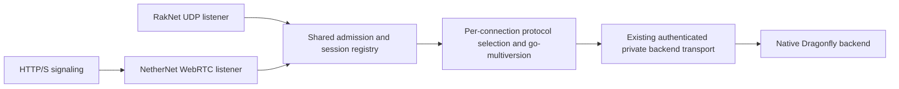

# Public RakNet and NetherNet admission

Status: the combined `feat/all_26_u6` branches integrate the published transport
candidates with [exact .30 data](../data/native2225/README.md). This repository pins
gophertunnel `4d6bffd4ed49` / 2225 and includes configured outgoing 2193 mapping.
The matching Dragonfly branch installs the captured registry with native block
hashes, and BRBW removes its temporary build-tag gate. Downstream fork publication,
immutable consumer pins and actual-client/external-network validation remain gates.

The implementation-run records below describe the earlier isolated candidates.
Their old branch names, module pins and deferred registry work are historical,
not the current integration state. The .29 bundle retains its original identity.

## Ownership and current seams

- `go-raknet` and `go-nethernet` own their transport mechanics.
- gophertunnel owns Minecraft framing, authentication, connection bootstrap and
  transport capabilities. Its pinned fork already exposes `ListenNetwork`,
  `NetherNet`, and a `ListenerGroup` that shares player-count admission between
  listeners. The group does not implement account replacement or session routing.
- go-multiversion owns historical wire and semantic conversion. It does not bind
  public sockets, implement signaling or choose product transport policy.
- Spectrum owns accepted player sessions, backend discovery and switching.
- BRBW owns regional public endpoints, certificates, operator identity, enabled
  protocols and transport settings, lifecycle wiring and actual-client validation.

Reference seams are the [gophertunnel listener](https://github.com/shawtymarco/gophertunnel/blob/34adb6db991480b8a7665959d10226078cf279fa/minecraft/listener.go),
[NetherNet adapter](https://github.com/shawtymarco/gophertunnel/blob/34adb6db991480b8a7665959d10226078cf279fa/minecraft/nethernet.go),
and [current Spectrum listener](https://github.com/shawtymarco/spectrum/blob/6c2de433179d/spectrum.go).
The original Spectrum base binds RakNet and stores one listener. The candidate
adds `ListenWith` to adopt multiple `minecraft.Listener` instances into one owner;
two unrelated Spectrum instances would split account replacement and routing.

## Admission and session state

1. The consumer creates one listener group, authentication policy, supported
   protocol catalogue, aggregate status provider and logical admission owner.
2. It opens RakNet plus the signaling/WebRTC resources. If any required transport
   fails to bind, startup closes every resource already opened and fails as a unit.
3. Bounded accept loops submit authenticated `minecraft.Conn` instances to one
   Spectrum registry. Each accepted connection has an opaque generation and its
   original listener/transport owner for disconnect and diagnostics.
4. Minecraft protocol selection remains per connection, using network settings or
   legacy Login plus GameVersion where required. Transport selection never implies
   a protocol version: versions supporting both may arrive through either listener.
5. Duplicate-account admission uses the existing product session/lease transition.
   A retiring connection may only remove its own generation. Concurrent RakNet and
   NetherNet logins must not leave two active sessions or erase the winning route.
6. Switching backend keeps the original public connection and its transport alive.
   Reconnecting to another public region uses a compatible public endpoint on that
   region and must preserve the configured server trust identity.
7. Shutdown first closes admission and all public listeners/signaling resources,
   then cancels and joins accepted initialization work before retiring sessions and
   backend streams. Every partial startup and failed login follows the same owner.

ListenerGroup maximum/count and `/v1/join` metadata must use the combined logical
server count. Independent limits for pending signaling and unauthenticated handshakes
are still needed because authenticated player count does not bound those resources.
Authentication is enabled on both public transports; NetworkID is an opaque transport
identifier and never substitutes for verified account identity.

## Endpoint and framing requirements

RakNet occupies its configured UDP endpoint. NetherNet needs HTTP/S signaling and
reachable WebRTC UDP candidates. TCP and UDP may share a numeric port, but the
WebRTC UDP binding must not collide with the RakNet socket. Choose an explicit
separate UDP endpoint/range first; a shared UDP socket would require a validated
STUN/DTLS/RakNet demultiplexer and is outside this initial design.

The signaling response must advertise public reachable candidates rather than
Docker/private addresses. Public HTTP/S, ICE UDP forwarding and certificates must
all be represented in the consumer configuration and deployment topology. A
successful HTTP probe alone does not establish a working WebRTC data connection.
The server operator identity key is persistent and distinct from the TLS key.

Connection wrappers must forward `packet.TransportCapabilities`, including
BatchHeader, DisableEncryption and ReadPacket. RakNet framing/Minecraft encryption
and NetherNet transport framing/encryption are selected by the actual connection,
not global flags. NetherNet encryption capabilities must not disable authentication
or encryption for a separate RakNet connection.

An attempted NetherNet connection must not silently downgrade server authentication
or reopen the same account through RakNet. Client transport fallback behavior is
separate from the server accepting both transports.

## Validation before enablement

| Boundary | Automated checks | Real-client checks |
| --- | --- | --- |
| Transport | Simultaneous accepts, capability forwarding, framing/crypto, no socket collisions | Exact-build NetherNet and historical RakNet connection |
| Admission | Shared count/limit, concurrent duplicate account, abandoned signaling/login, generation-safe cleanup | Reconnect through the other transport |
| Protocol | Same version independently selected on each supported transport, historical packet oracles | Login, packs, chunks, inventory and UI with correct registries |
| Routing | Backend switch retains public transport, retired backend packets rejected, stream shutdown | Lobby/game/replay and public regional transfer |
| Lifecycle | Partial-bind rollback, cancel/join, bounded pending accepts, idempotent close | Recovery after listener/server restart |
| Deployment | Signaling and UDP endpoint configuration, reachable candidate assertions, certificate/trust validation | External network and device matrix, rather than loopback alone |

The go-multiversion CI runs library regressions, independent packet oracles and
the exact pinned gophertunnel transport/session tests. The candidate integration
tests below establish the multi-listener owner and local HTTP/WebRTC path. External
ICE reachability and Mojang-client semantics remain unverified; no CI dispatch or
monitoring was performed for this candidate.

## Isolated implementation locks

All candidates are local commits on separate `codex/dual-transport` branches.
go-multiversion starts from local `9f2f9c5d87069ead2e4fbde2082cb80d85ad60e6`;
this repository changes documentation only and retains its committed dependency.

| Repository | Base | Candidate |
| --- | --- | --- |
| gophertunnel | `8fe51a21de6d872394eed2b59d67b35e46fd52ac` | `4d6bffd4ed49ac9298d6abaa329415432a16f3e4` |
| Spectrum | `03aca887b66d746ad2b79b34e57bb93e2623dc34` | `e8cb3a96a9f6052748e6bd62114ee6e185f4ab58` |
| SpectrumDF | `763ae4cb12bb3ed55ae3673eb839ab8b12d4e8ee` | `f69ebbc09f52f0d9415bb9e6c7e473b4bd1e56de` |
| Dragonfly | `92ccc8ebb41e46c83114ac1c8d31dd0d6249f0cf` | `492f88730cc591e6a825d6035c7f8639a95b2729` |
| BRBW | `7879ad3fc3e2351167531407690e6f6d8c31dc7e` | `b3ac9af9ee4db0e025790da95b9f2f02d3be9897` |

Spectrum's `frontend` factories share authentication/catalogue/pack policy and
count, keep MaximumMTU on RakNet, own bounded signaling and pending login work,
load an operator-supplied persistent identity and bind a separate ICE UDP mux.
Session registration is generation-safe; shutdown covers pre-registry sessions
and joins initialization. Initial backend rejection terminates login rather than
spinning on fallback. gophertunnel fixes zero-value RakNet construction and joins
pre-auth connection readers/count cleanup; its inherited reliable RakNet close
drain can take roughly five seconds.

SpectrumDF accepts `nethernet://<network-id>/<connection-id>` in the existing
ConnectionRequest address string. BRBW admission and backend account metadata do
not treat it as an IP. The private QUIC/SpectrumDF frame protocol remains intact.
Dragonfly only removes the two references to the deleted native Skin.PlayFabID
field, confirmed by comparing gophertunnel `9e7f28092180` to `8fe51a21de6d`.
Its skin round-trip test retains other metadata and input immutability. This is a
native compile bridge, not a Dragonfly registry upgrade or standalone stable patch.

BRBW production pins/configuration remain unchanged. Its candidate binder requires
the `spectrum_dual_transport` build tag and `nethernet.enabled`; requesting it in a
normal build fails explicitly. Spectrum pins only the already published fork
`4ea1495a39f2`/2223 for its public API baseline; its new dual path still requires
the unpublished lifecycle fixes through a disposable override. Do not claim plain
production-pin dual-transport tests passed or publish a local-path replacement.

## Local verification record

`candidate.mod` below means a disposable copy of go.mod/go.sum with local
replacements for the exact candidate checkouts in the table, never committed.
The BRBW modfile replaces Spectrum, SpectrumDF, gophertunnel, Dragonfly and
go-multiversion together; the smaller modules replace only their dependencies.
Use `go mod edit -modfile=candidate.mod -replace=MODULE=CHECKOUT` followed by
`go mod tidy -modfile=candidate.mod` to construct it. Delete the disposable files
after verification. Source review, gofmt, diff checks and local doc links passed.

| Scope | Commands/results |
| --- | --- |
| gophertunnel | `go test ./...`, `go vet ./...`; WSL `go test -race ./minecraft ./minecraft/protocol/packet`: passed |
| go-multiversion | `go test -modfile=candidate.mod ./...`, `go vet -modfile=candidate.mod ./...`: passed, including historical wire/transport regressions |
| Spectrum | Full tests/vet with candidate modfile and WSL `go test -modfile=candidate.mod -race ./...`: passed |
| SpectrumDF | Full tests/vet with published pins and candidate modfile; WSL full race with published pins: passed |
| Dragonfly | Full tests/vet with candidate modfile: passed |
| BRBW Proxy, production pins | WSL `go test -mod=readonly ./...`, `go vet -mod=readonly ./...`, `go test -race -mod=readonly ./...`: passed |
| BRBW Proxy, candidate | Tagged `TestPublicTransport`, admission/network-session/metadata tests with candidate modfile, vet and WSL race: passed |
| BRBW shared address hash | Moderation/proxycontrol/sessionlease tests/vet and Lobby, BedWars, Conquests `server/user` consumer tests/vet: passed |

Windows's existing QUIC companion-port fixture could not reserve a port during
the broad Proxy run, and Windows race lacked a C compiler. Those checks were run
successfully in the existing Ubuntu WSL environment. No server binary, Compose
service or production VPS was started for manual validation.

The candidate uses real RakNet and NetherNet HTTP/WebRTC for concurrent joins,
count/limit/status, duplicate identity replacement, rollback and shutdown. BRBW's
actual mTLS QUIC/SpectrumDF transfer fixture checks native 2225 and outgoing 2193
through each public transport, preserving the public connection and rejecting
retired backend visibility packets. These are offline automated fixtures, not
Xbox account authentication or a real-client semantic matrix.

## Reference and release boundary

WDPE master was inspected at `aac47b18e29d8977dc613da9f39b632b8832bc80`.
[PR 463](https://github.com/WaterdogPE/WaterdogPE/pull/463) is merged at
`cca3bb256771323c1bd2f541f7886d845b6fe158`. Public interfaces feed common
Bedrock sessions/authentication and per-client protocol selection; backend
connections and transfers retain the player's public session. The independently
authored Spectrum implementation follows that separation but keeps its private
framed backend transport. Unlike WDPE's inspected degradation behavior, a required
Spectrum listener bind failure rolls back the whole listener set.

[PR 470](https://github.com/WaterdogPE/WaterdogPE/pull/470) (Xbox login forwarding,
head `78b41819bf91d733a6cb4148cd3b75c77cea0adf`) and
[PR 471](https://github.com/WaterdogPE/WaterdogPE/pull/471) (forced-host handling,
head `1129ac4dd42bb991fd662d417fa4cf7e9f55f163`) were open when checked; their
features are not claimed as merged or reproduced. No GPL WDPE code was copied.

Mojang's [26.50.24 notes](https://feedback.minecraft.net/hc/en-us/articles/47907593889677-Minecraft-Beta-Preview-26-50-24)
establish the BDS NetherNet default, and its
[26.60.22/23 notes](https://feedback.minecraft.net/hc/en-us/articles/48740748263565-Minecraft-Beta-Preview-26-60-22-23)
turn BDS RakNet deprecation into an error. The checked official material does not
establish the removal matrix for every client, Xbox path or platform/build.

Still required before enablement: dependency publication/re-pinning, exact .30
registry validation, Mojang/Xbox client tests, externally reachable ICE/TLS and
identity persistence checks, and public regional Transfer validation. No .30
data extraction, BDS modding, deployment, fork publication or main integration
was performed. The existing `data/native2223` remains exclusively .29 data.
